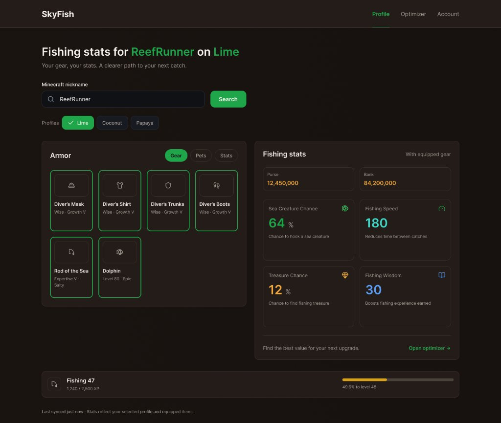
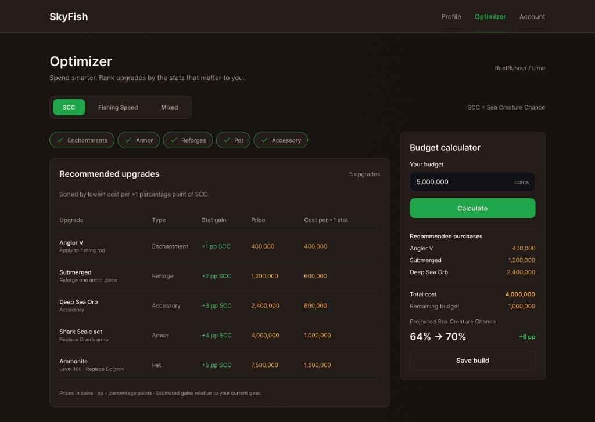
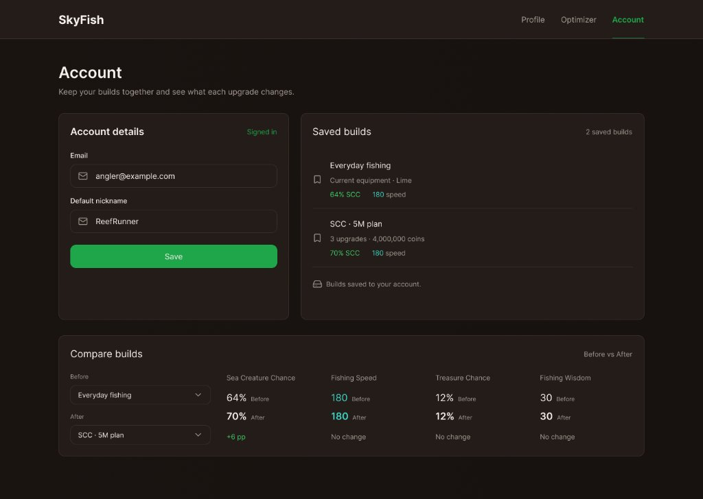

Державний вищий навчальний заклад  
«Ужгородський національний університет»  
Факультет інформаційних технологій  

  

# ЛАБОРАТОРНА РОБОТА
### Тема: Розробка та представлення ідеї проєкту веб-додатку

  

**Виконав:**  
студент **ІІ курсу**  
спеціальності «Інженерія програмного забезпечення»  
**Росоха Іван Михайлович**  

  

**Ужгород – 2026**

---

### МЕТА РОБОТИ
Дослідження ринку сучасних веб-сервісів у сфері ігрової аналітики та економіки; формулювання та детальне представлення концепції авторського веб-застосунку **«SkyFish Optimizer»** (інструмент для гравців режиму Hypixel SkyBlock); проєктування структури сторінок та цифрових макетів інтерфейсу (мокапів); обґрунтування вибору технологічного стеку (React 18, Vite, Tailwind CSS) та методів комбінаторної оптимізації.

---

### ЗАВДАННЯ ДО РОБОТИ
1. Провести порівняльний аналіз існуючих аналогів і веб-інструментів у цільовій предметній області, виявити їхні недоліки та визначити ключові покращення власного веб-застосунку.
2. Скласти детальний опис ідеї проєкту, його цільової аудиторії, функціональних модулів та архітектури взаємодії з зовнішніми джерелами даних (API).
3. Розробити графічне представлення інтерфейсу (цифрові мокапи/вайрфрейми) для ключових екранів багатосторінкового застосунку (мінімум 3 сторінки + екран авторизації).
4. Описати математичну модель розрахунку ефективності витрат (*Cost per Stat*) та алгоритм оптимізації розподілу бюджету.
5. Сформулювати аналітичні висновки за результатами проведеного дослідження та проєктування.

---

# ХІД РОБОТИ

## 1. АНАЛІЗ ІСНУЮЧИХ РІШЕНЬ ТА ОБҐРУНТУВАННЯ ПОКРАЩЕНЬ

У ході аналізу сучасних веб-інструментів для гравців MMORPG-режиму Hypixel SkyBlock (Minecraft) було досліджено наявні програмні рішення:

1. **SkyCrypt (`sky.shiiyu.moe`):** Найбільш відомий open-source сервіс для перегляду профілів. Має якісний, високодеталізований дизайн та відмінну ергономіку інтерфейсу на високому рівні.
   * *Головне обмеження:* Застосунок є виключно пасивним переглядачем профілів (Profile Viewer). Він чудово демонструє вже наявне у гравця спорядження, проте взагалі не містить аналітичного блоку оптимізації та рекомендацій — гравець не отримує жодної відповіді на питання, який предмет найвигідніше придбати далі для максимізації показників з урахуванням ринкових цін.
2. **SkyBlockTools (`skyblocktools.dev`):** Калькулятор улову та погодинного заробітку.
   * *Недолік:* Не має інтеграції з API профілю гравця, вимагає ручного введення десятків числових значень характеристик, не враховує динаміку ринкових цін на Аукціоні (Auction House) та Базарі (Bazaar).
3. **Спільнотні розрахункові таблиці (Google Spreadsheets):**
   * *Недолік:* Мають складну навігацію, вимагають постійного оновлення формул користувачем, не адаптовані під мобільні екрани та не мають інтегрованого механізму уникнення конфліктів спорядження.

### Порівняльна таблиця характеристик аналогів

| Критерій порівняння | SkyCrypt | SkyBlockTools | Спільнотні таблиці | **SkyFish Optimizer (наш проєкт)** |
| :--- | :---: | :---: | :---: | :---: |
| Призначення платформи | Пасивний огляд профілю | Калькулятор улову (ручний) | Статичні таблиці | **Інтерактивна оптимізація спорядження** |
| Автоматичний парсинг спорядження через API | Так | Ні | Ні | **Так (Hypixel API + Mojang)** |
| Інтеграція з динамічними ринковими цінами | Ні | Ні | Частково | **Так (Bazaar API + Coflnet LBIN)** |
| Розрахунок метрики «ціна за +1 стат» (Cost/Stat) | Відсутній | Відсутній | Ручний | **Автоматичний у реальному часі** |
| Підбір оптимального комплекту під бюджет | Відсутній | Відсутній | Відсутній | **Так (алгоритм розв'язання рюкзака)** |
| Особистий кабінет та збереження збірок | Ні | Ні | Ні | **Так (Firebase Auth + Firestore)** |
| Адаптивність та якість UI/UX | **Висока** (лише огляд) | Середня | Низька | **Висока (React + Vite, Tailwind)** |

### Ключові покращення, реалізовані у проєкті
* **Усунення когнітивного навантаження на гравця:** Замість самостійного аналізу цін сотень зачарувань і предметів система в один клік розраховує питому вартість кожного відсоткового пункту характеристик.
* **Автоматизований захист від колізій (Multi-Choice Knapsack):** Алгоритм гарантує, що у сформованому кошику покупок не опиняться взаємовиключні предмети (два шоломи, два однакових рефорджі чи два активні пети).
* **Стійка серверна архітектура:** Використання Serverless Proxy знімає проблему блокування запитів політикою CORS у браузері та захищає персональний API-ключ розробника від витоку.

---

## 2. ДЕТАЛЬНИЙ ОПИС ІДЕЇ ТА АРХІТЕКТУРИ ВЕБ-ЗАСТОСУНКУ

**SkyFish Optimizer** — це багатосторінковий клієнтський SPA-застосунок (Single Page Application), покликаний оптимізувати процес розвитку навички риболовлі (Fishing) у Hypixel SkyBlock.

### 2.1. Технологічний стек
* **Збирач:** **Vite** (миттєве гаряче оновлення модулів HMR, швидкий production-білд).
* **Frontend:** **React 18** (функціональні компоненти, користувацькі хуки).
* **Маршрутизація:** **React Router v6** (підтримка захищених переходів `ProtectedRoute`).
* **Стилізація:** **Tailwind CSS** (стилізована темна тема у стилі RPG/Minecraft).
* **Управління глобальним станом:** **Zustand** (кешування стану сесії, обраного профілю та кошика).
* **Мережа та кешування:** **TanStack Query** (автоматичне фонове оновлення, skeleton loading).
* **Автентифікація та база даних:** **Firebase Auth** (Email/Password) та **Cloud Firestore** для збереження кастомних пресетів.

### 2.2. Джерела даних та схема взаємодії
Застосунок поєднує нормалізований статичний датасет характеристик гри (`fishing-data.json`, складений на основі офіційної вікі `hypixelskyblock.minecraft.wiki`) з трьома динамічними джерелами цін:
1. **Hypixel Bazaar API:** отримання цін у реальному часі на наживки, зачаровані книги, витратні матеріали.
2. **Coflnet API:** отримання мінімальних цін викупу (Lowest BIN) для готової броні, вудок, талісманів та петів.
3. **Hypixel Profiles API:** отримання даних профілю гравця та сирих NBT-масивів інвентарю.

---

## 3. ГРАФІЧНЕ ПРЕДСТАВЛЕННЯ ІНТЕРФЕЙСУ (МОКАПИ ВЕБ-ЗАСТОСУНКУ)

Дизайн інтерфейсу розроблено згідно з принципами ергономіки та сучасного UI/UX у темній палітрі з акцентним підсвічуванням важливих числових значень.

### 3.1. Екран 1: Головна панель та огляд профілю (`/profile`)
Екран призначений для пошуку гравця та експрес-оцінки поточного білду.

*Рис. 1. Екран огляду профілю та характеристик спорядження*

**Опис компонентів екрана:**
* **Блок пошуку:** Поле введення нікнейму Minecraft з валідацією та селектор слотів збереження (`Lime`, `Coconut`, `Papaya`).
* **Картка екіпірування:** Вкладки `[Gear]`, `[Pets]`, `[Stats]` з візуалізацією 6 активних предметів (4 слоти броні, вудка *Rod of the Sea*, активний пет *Dolphin*).
* **Картка показників (Fishing stats):** Фінансовий баланс гравця (*Purse*, *Bank* з обробкою приватності), бойові стати (*Sea Creature Chance (64%)*, *Fishing Speed (180)*, *Treasure Chance*, *Fishing Wisdom*) та кнопка швидкого переходу до оптимізатора `Open optimizer ->`.
* **Індикатор навички:** Нижня смуга прогресу з рівнем *Fishing 47* та детальним відображенням відсотка до наступного рівня (49.6%).

---

### 3.2. Екран 2: Оптимізатор спорядження та калькулятор бюджету (`/optimizer`)
Основне аналітичне вікно прийняття фінансових рішень.

*Рис. 2. Екран оптимізатора спорядження та бюджетного планування*

**Опис компонентів екрана:**
* **Фокус оптимізації:** Селектор пріоритетної характеристики `[SCC]`, `[Fishing Speed]`, `[Mixed]`.
* **Фільтри категорій:** Мультиселектні чіпи для вибору категорій `[✓ Enchantments]`, `[✓ Armor]`, `[✓ Reforges]`, `[✓ Pet]`, `[✓ Accessory]`.
* **Таблиця покращень:** Динамічний перелік доступних на ринку апгрейдів (наприклад, *Angler V*, *Submerged*, *Deep Sea Orb*, *Shark Scale set*), відсортований за показником *Cost per +1 stat*.
* **Віджет калькулятора бюджету:** Поле введення ліміту монет (`5,000,000 coins`), кнопка запуску розрахунку `[Calculate]`, список рекомендованих покупок, прогнозований сумарний приріст (`64% -> 70% (+6 pp)`) та кнопка **`[Save build]`** для збереження конфігурації.

---

### 3.3. Екран 3: Особистий кабінет та менеджер збірок (`/account`)
Захищений простір авторизованого користувача для збереження та зіставлення білдів.

*Рис. 3. Екран особистого кабінету та матриці порівняння білдів*

**Опис компонентів екрана:**
* **Обліковий запис:** Дані користувача, статус сесії та збереження основного нікнейму за замовчуванням (*Default nickname*).
* **Реєстр білдів:** Список збережених сетапів (*«Everyday fishing»*, *«SCC 5M plan»*) з мітками статів та вартості.
* **Матриця порівняння («Before / After»):** Інструмент зіставлення двох конфігурацій за всіма 4 параметрами з автоматичним розрахунком дельти (наприклад, `+6 pp SCC`, `No change`).

---

### 3.4. Екран 4: Автентифікація користувача (`/login`)
Екран авторизації для забезпечення збереження налаштувань між різними пристроями.

*Рис. 4. Екран авторизації користувача*

**Опис компонентів екрана:**
* Перемикач вкладок `[Login]` / `[Register]`.
* Валідовані поля Email, Password та кнопка скидання пароля (*Forgot password?*).
* Кнопка `Log in` для завершення входу.

---

## 4. МАТЕМАТИЧНА МОДЕЛЬ ТА АЛГОРИТМ РОЗРАХУНКУ

### 4.1. Метрика питомої ефективності
Для кожного доступного поліпшення розраховується показник питомих витрат за формулою:

$$\text{Efficiency} = \frac{\text{Ринкова ціна апгрейду (монети)}}{\Delta \text{Приріст цільової характеристики}}$$

* У разі $\Delta \le 0$ елемент автоматично відсікається для уникнення ділення на нуль і виключення неефективних дій.
* Для зачарувань різниця рівнів розраховується з урахуванням вартості докупівлі лише цільового рівня книги.

### 4.2. Модель розподілу бюджету (Multiple-Choice Knapsack Problem)
Задача пошуку комбінації покупок формулюється як максимізація приросту цільового стату при обмеженні бюджету $B$:

$$\max \sum_{i \in S} \Delta \text{Stat}_i \quad \text{при} \quad \sum_{i \in S} \text{Cost}_i \le B$$

За умови належності предметів до неперетинних груп взаємовиключення $G_k$ (шолом, нагрудник, штани, чоботи, рефордж вудки, активний пет):
$$\forall k, \quad |S \cap G_k| \le 1$$

Розв'язання реалізується за допомогою методів динамічного програмування (точний розрахунок) із швидким жадібним евристичним перемикачем.

---

### ВИСНОВКИ

У ході виконання лабораторної роботи було проведено комплексне дослідження предметної галузі веб-аналітики ігрових економік та спроєктовано архітектуру спеціалізованого веб-застосунку **«SkyFish Optimizer»**.

1. **Аналітичне обґрунтування ідеї:** На основі дослідження встановлено, що сучасні рішення (SkyCrypt, SkyBlockTools) або обмежені пасивною демонстрацією даних, або вимагають виснажливого ручного заповнення форм. Доведено доцільність створення інтелектуального помічника, який автоматизує аналіз інвентарю через API та вираховує математичну вигоду вкладень (*Cost per Stat*), що суттєво економить час користувача та усуває людський фактор при виборі спорядження.
2. **Технічні рішення та архітектура:** Обґрунтовано застосування клієнтського фреймворку **React 18** під керуванням збирача **Vite**, що забезпечує максимальну швидкодію SPA-інтерфейсу без перезавантаження сторінок. Запропоновано використання проміжного шару (Serverless Proxy) як оптимального шляху вирішення проблеми CORS-політики та надійного захисту секретних ключів Hypixel API.
3. **Проєктування інтерфейсів:** Розроблено узгоджену систему цифрових мокапів для 4 взаємопов'язаних екранів (профіль, оптимізатор, кабінет, авторизація). Інтерфейс успішно адаптовано під темну естетику RPG-проєктів з чітким акцентуванням функціональних кнопок і кольоровим кодуванням категорій предметів (`Enchantments`, `Armor`, `Reforges`, `Pet`, `Accessory`).
4. **Математична верифікація:** Сформульовано модель комбінаторного бюджетного планування на основі задачі про рюкзак з групами несумісності (*Multiple-Choice Knapsack*), яка виключає конфлікти екіпірування та гарантує досягнення максимального приросту характеристик у межах доступних ігрових монет.

Спроєктований веб-застосунок має високу практичну цінність, відповідає всім критеріям навчальної програми кафедри та готовий до етапу програмної імплементації.
