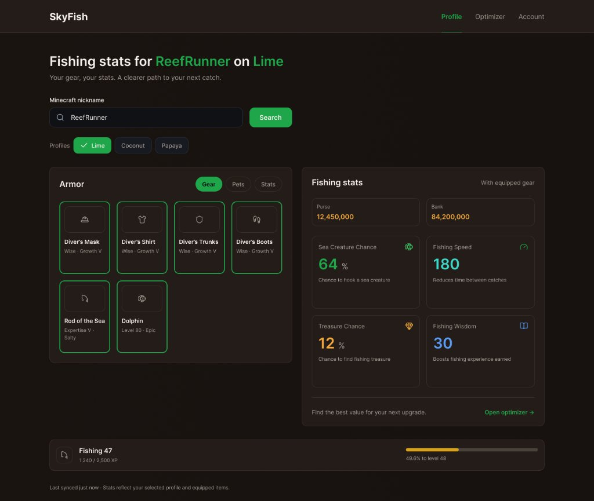
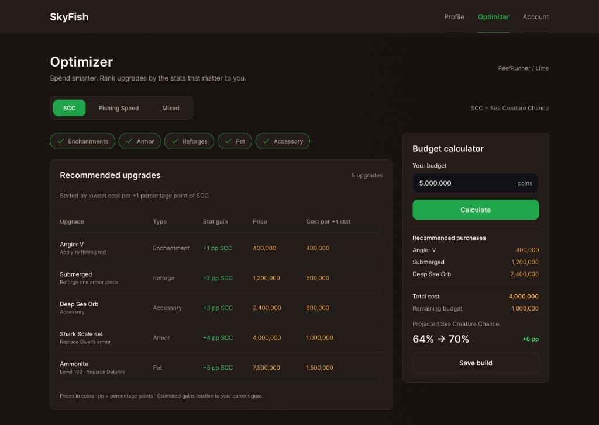
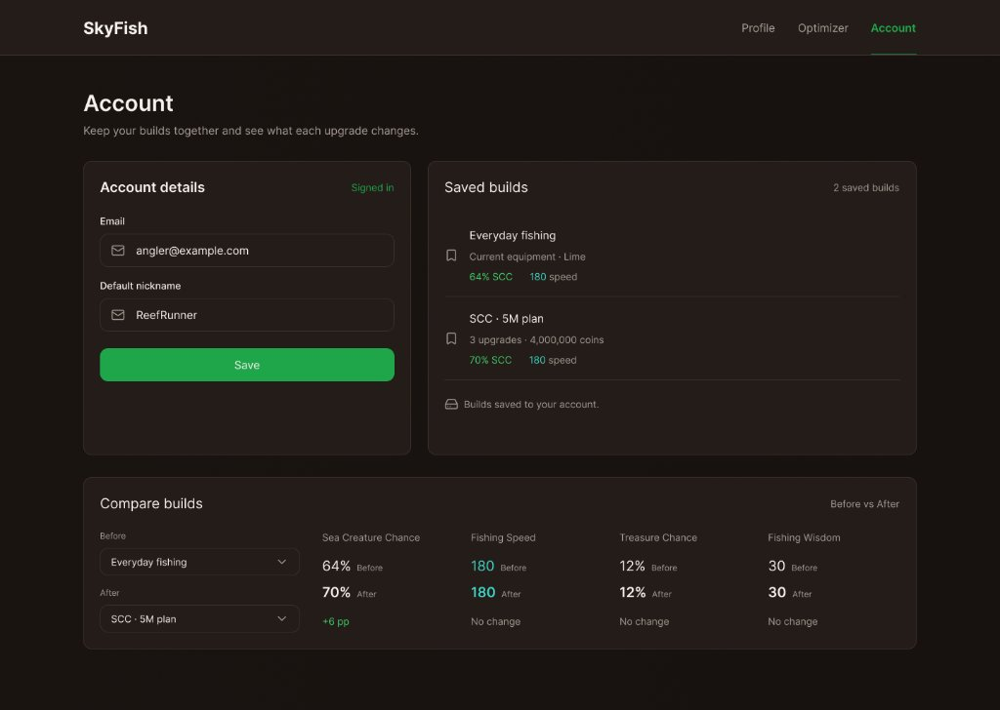
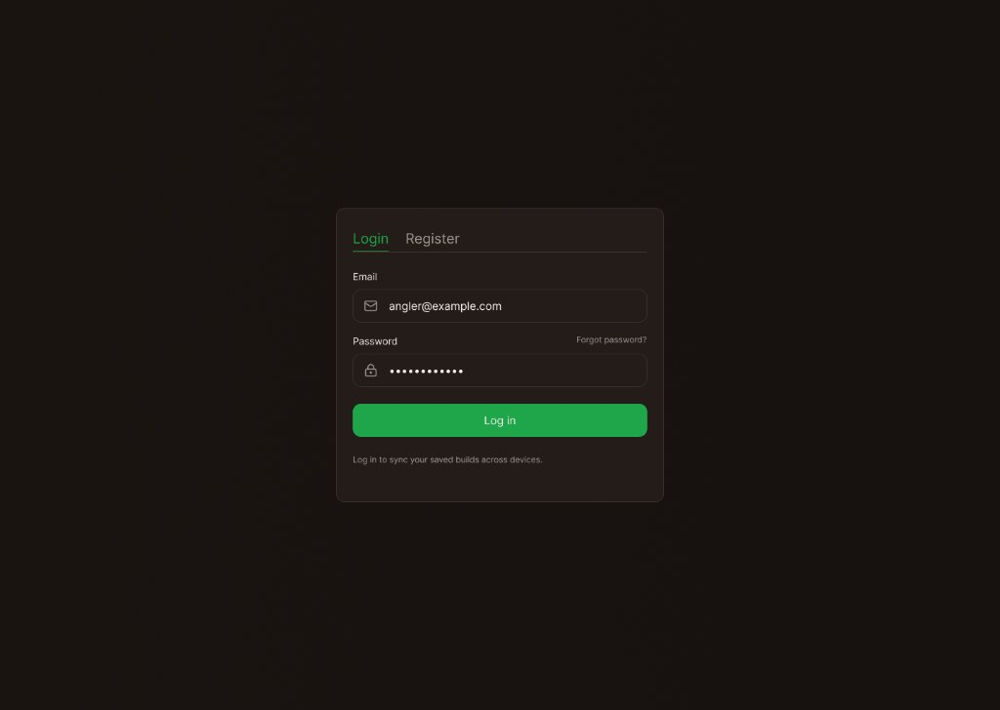

Державний вищий навчальний заклад  
«Ужгородський національний університет»  
Факультет інформаційних технологій  

<br><br>

# ЛАБОРАТОРНА РОБОТА № 2
### Тема: Власна ідея веб-додатку. Частина 2 — дизайн та система контролю версій Git

<br><br>

**Виконав:**  
студент **ІІ курсу**  
спеціальності «Інженерія програмного забезпечення»  
**Росоха Іван Михайлович**  

<br><br>

**Ужгород – 2026**

---

### МЕТА РОБОТИ
Створення фінального користувацького інтерфейсу (UI/UX) веб-застосунку «SkyFish Optimizer», розробка дизайн-системи проєкту (палітра кольорів, типографіка, компонентна база); налаштування системи контролю версій Git, публікація кодової бази на GitHub під університетським обліковим записом, організація командної співпраці через механізм гілкування (branching) та відкриття Pull Request для викладачів.

---

### ЗАВДАННЯ ДО РОБОТИ
1. Представити детальний опис концепції веб-застосунку на основі попередньої роботи з обов'язковою наявністю ілюстрацій архітектури та взаємодії.
2. Розробити та детально описати фінальний дизайн веб-сайту для всіх ключових сторінок (Профіль, Оптимізатор, Особистий кабінет, Авторизація).
3. Сформувати дизайн-систему (UI Kit) проєкту з визначенням кольорової гами, типографіки та станів інтерактивних елементів.
4. Налаштувати локальний репозиторій Git із прив'язкою до університетської пошти (`ivan.rosokha@student.uzhnu.edu.ua`).
5. Створити віддалений репозиторій `skyfish-optimizer` на GitHub, опублікувати гілку `main` та робочу гілку `feature/design-and-docs`.
6. Створити Pull Request у репозиторії та додати викладача `romanbuchuk` у переглядачі (Reviewers) та колаборатори.
7. Сформулювати аналітичні висновки щодо результатів проєктування та організації робочого процесу.

---

# ХІД РОБОТИ

## 1. ОПИС КОНЦЕПЦІЇ ТА АРХІТЕКТУРИ ПРОЄКТУ

**«SkyFish Optimizer»** — спеціалізований веб-сервіс для гравців режиму Hypixel SkyBlock (Minecraft), що автоматизує підбір найвигідніших покращень рибальського спорядження на основі аналізу динамічних ринкових цін Базару й Аукціону та розрахунку метрики питомої вартості *Cost per +1 Stat*.

### 1.1. Архітектура застосунку та джерела даних
```text
[ Клієнт: React 18 + Vite SPA ]
       │
       ├──> [ Локальний нормалізований датасет: fishing-data.json ]
       │
       └──> [ Серверний проксі (Serverless Proxy) ]
                 ├──> Hypixel Bazaar API (ціни зачарувань, наживок)
                 ├──> Coflnet LBIN API (мінімальні ціни броні, вудок, аксесуарів)
                 └──> Hypixel Profiles API (NBT-інвентар гравця через Mojang UUID)
```

---

## 2. ФІНАЛЬНИЙ ДИЗАЙН ВЕБ-САЙТУ (UI/UX)

Інтерфейс виконано у темній RPG-палітрі з високим контрастом, що відповідає візуальній культурі гри та мінімізує навантаження на зір під час тривалих ігрових сесій.

### 2.1. Екран 1: Огляд профілю та спорядження (`/profile`)

*Рис. 1. Фінальний дизайн головної панелі профілю рибалки*

* **Блок пошуку:** поле швидкого пошуку гравця за нікнеймом із селектором ігрових профілів (*Lime, Coconut, Papaya*).
* **Картка екіпірування:** інтерактивні слоти спорядження з вкладками `[Gear]`, `[Pets]`, `[Stats]`, що відображають броню (*Diver's Set*), вудку (*Rod of the Sea*) та активного пета (*Dolphin*).
* **Статистика та фінанси:** відображення балансу гаманця (*Purse*) та банку (*Bank*), поточні показники *Sea Creature Chance (64%)*, *Fishing Speed (180)*, *Treasure Chance (12%)* та кнопка переходу до оптимізатора.
* **Смуга прогресу навички:** індикатор *Fishing 47* з точним підрахунком відсотків до 48 рівня (49.6%).

---

### 2.2. Екран 2: Оптимізатор апгрейдів та калькулятор бюджету (`/optimizer`)

*Рис. 2. Фінальний дизайн оптимізатора спорядження та бюджетного планування*

* **Селектор мети:** перемикач цільової оптимізації `[SCC]`, `[Fishing Speed]`, `[Mixed]`.
* **Фільтри категорій:** чіпи швидкої фільтрації `[✓ Enchantments]`, `[✓ Armor]`, `[✓ Reforges]`, `[✓ Pet]`, `[✓ Accessory]`.
* **Аналітична таблиця:** перелік рекомендованих покращень, відсортований за найменшою ціною за $+1$ одиницю стату.
* **Калькулятор бюджету:** модуль автоматичного збору кошика на задану суму (наприклад, 5,000,000 монет) з розрахунком сумарного приросту статів (`64% -> 70% (+6 pp)`) та кнопкою швидкого збереження пресету `[Save build]`.

---

### 2.3. Екран 3: Особистий кабінет та менеджер пресетів (`/account`)

*Рис. 3. Фінальний дизайн кабінету та інструменту порівняння білдів*

* **Налаштування акаунту:** збереження дефолтного нікнейму для автоматичного завантаження даних.
* **Збережені білди:** картки кастомних сетапів (*«Everyday fishing»*, *«SCC 5M plan»*).
* **Матриця порівняння «Before / After»:** наочне зіставлення статів між двома конфігураціями спорядження.

---

### 2.4. Екран 4: Модуль автентифікації (`/login`)

*Рис. 4. Модальний інтерфейс входу та реєстрації користувача*

* Лаконічна картка входу/реєстрації для збереження пресетів у хмарній базі даних (Firebase Auth).

---

## 3. ДИЗАЙН-СИСТЕМА ПРОЄКТУ (UI KIT)

Для забезпечення цілісності інтерфейсу розроблено єдину систему стилістичних констант:

### 3.1. Кольорова палітра (Color Palette)
| Роль кольору | HEX-код | Візуальний приклад / Застосування |
| :--- | :--- | :--- |
| **Primary Background** | `#0c0a09` / `#121214` | Основний фон застосунку |
| **Card Surface** | `#18181b` | Картки спорядження, панелі віджетів |
| **Borders / Separators** | `#27272a` | Роздільні лінії, межі інпутів |
| **Accent / Success** | `#22c55e` (Emerald) | Кнопки дій, позитивний приріст статів, активні чіпи |
| **Secondary Accent** | `#06b6d4` (Cyan) | Інформаційні бейджі, посилання, показники досвіду |
| **Warning / Speed** | `#eab308` (Amber) | Показники Fishing Speed |
| **Text Primary** | `#f4f4f5` | Основний текст, назви предметів |
| **Text Muted** | `#71717a` | Підписи параметрів, неактивні елементи |

### 3.2. Типографіка
* **Основний шрифт:** `Inter`, `system-ui`, `sans-serif` (висока читабельність дрібних числових значень).
* **Моноширинний шрифт:** `ui-monospace`, `JetBrains Mono` (для відображення цін монет та формул).

---

## 4. РОБОТА З СИСТЕМОЮ КОНТРОЛЮ ВЕРСІЙ GIT ТА GITHUB

Згідно з інженерними вимогами завдання, робочий процес організовано з використанням системи контролю версій Git та сервісу GitHub.

### 4.1. Налаштування профілю та репозиторію
* **Обліковий запис GitHub:** `https://github.com/ivanrosokha-ux` (зареєстрований на університетську пошту `ivan.rosokha@student.uzhnu.edu.ua`).
* **Репозиторій проєкту:** `https://github.com/ivanrosokha-ux/skyfish-optimizer`

### 4.2. Організація гілкування (Branching) та Pull Request
1. У локальному репозиторії створено базову гілку `main` із початковим коммітом структури проєкту.
2. Для оформлення дизайну та документації виділено окрему тематичну гілку:
   ```bash
   git checkout -b feature/design-and-docs
   ```
3. До гілки включено директорію документації `docs/` (із ТЗ, мокапами та звітом) та вихідний каркас `src/`.
4. Зміни опубліковано на віддалений сервер, відкрито офіційний **Pull Request** у гілку `main`:
   * **Посилання на Pull Request:** `https://github.com/ivanrosokha-ux/skyfish-optimizer/pull/1`
   * **Призначені переглядачі (Reviewers):** викладач `romanbuchuk`.
   * **Колаборатори:** надіслано запрошення викладачу `romanbuchuk` у налаштуваннях репозиторію (`Settings -> Collaborators`).

---

### ВИСНОВКИ

У процесі виконання лабораторної роботи № 2 було успішно реалізовано дизайн-концепцію веб-додатку «SkyFish Optimizer» та налаштовано сучасний інженерний воркфлоу на базі системи Git.

1. **Завершення етапу UI/UX проєктування:** Створено цілісну дизайн-систему (UI Kit) у темній темі, яка гармонійно поєднує естетику Minecraft/RPG із вимогами ергономіки сучасних веб-додатків. Реалізовано 4 повноцінні макети сторінок із продуманою компонентною базою (чіпи фільтрів, таблиця з підсвічуванням питомої ефективності, бічний калькулятор рюкзака).
2. **Організація версіонування коду:** Налаштовано репозиторій згідно зі стандартами GitFlow. Розмежування стабільної гілки `main` та функціональної гілки `feature/design-and-docs` дозволяє прозоро відстежувати зміни коду та документації.
3. **Командна взаємодія (Code Review):** Опубліковано напрацювання на GitHub, створено Pull Request та підключено викладачів як рев'юверів, що відповідає промисловим практикам командної розробки програмного забезпечення.

Спроєктований інтерфейс та налаштована інфраструктура репозиторію формують надійну основу для наступного етапу — програмної реалізації фронтенду на базі React 18 та Vite.
