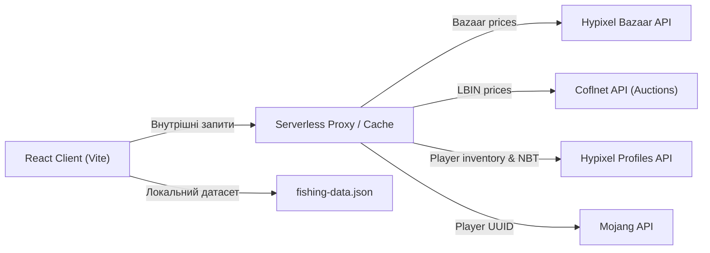
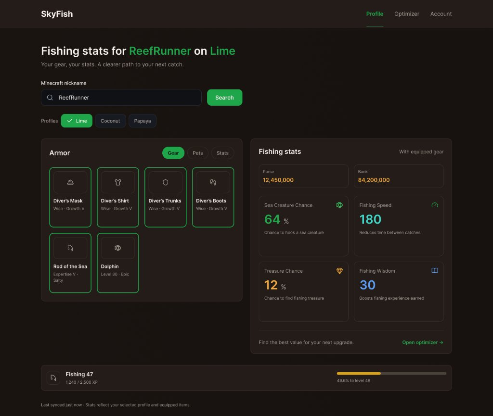
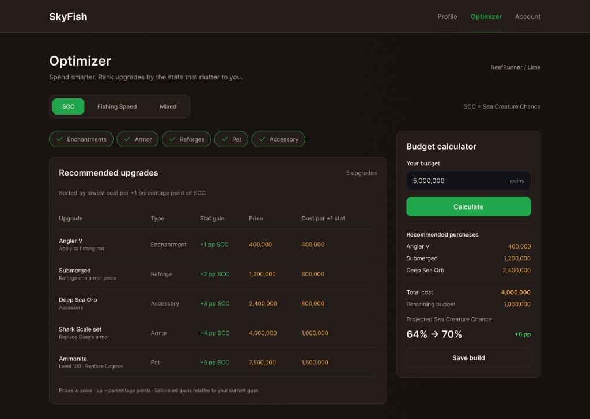
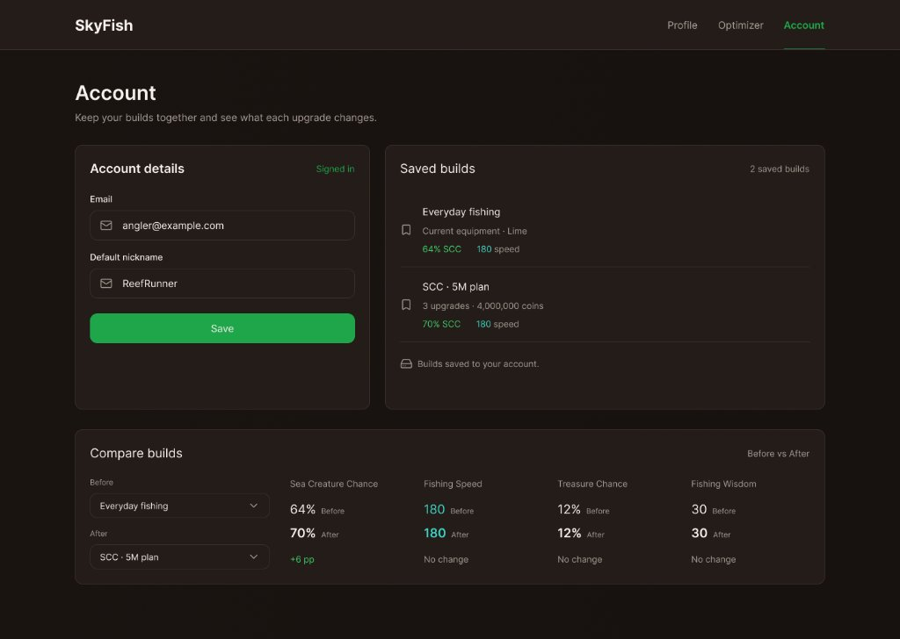
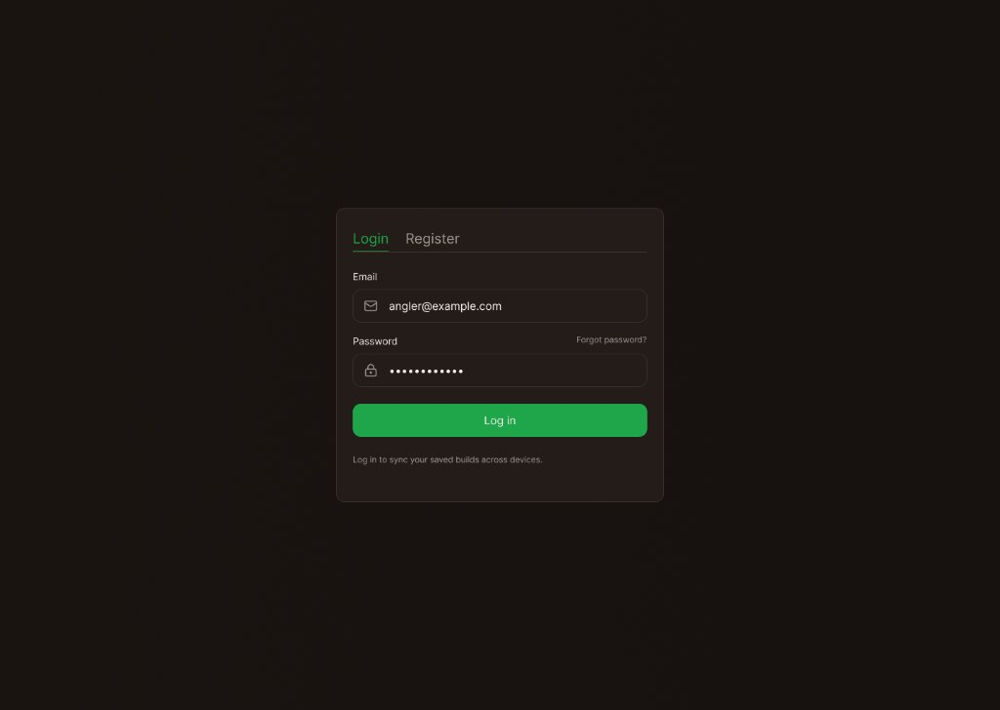

# Технічне завдання: веб-застосунок «SkyFish Optimizer» (v2.1)

Інструмент оптимізації рибальського спорядження у **Hypixel SkyBlock**: інтелектуально розраховує, які саме покращення спорядження дають найбільший приріст характеристик за найменшу вартість (метрика *Cost per +1 Stat*).

---

## 0. Синхронізація ТЗ з мокапами інтерфейсу (Changelog v2.1)

1. **Тип `Accessory`:** Офіційно додано у перелік типів покращень у ТЗ та фільтри оптимізатора (разом з `Enchantment`, `Armor`, `Reforge`, `Pet`). Враховує спеціальні рибальські талісмани (наприклад, *Deep Sea Orb* тощо).
2. **Фінансовий стан та досвід гравця на `/profile`:** Додано відображення `Purse` (монети в гаманці), `Bank` (з обробкою приватності Bank API) та `Fishing Level` з точним прогрес-баром XP до наступного рівня.
3. **Вкладки перегляду спорядження:** Картка спорядження на сторінці профілю містить вкладки `[Gear]`, `[Pets]`, `[Stats]` для детального аналізу.
4. **Оновлення маршрутизації:** 
   - `/login` — виділений екран / модальне вікно для входу та реєстрації (Login / Register).
   - `/account` — персональний захищений кабінет користувача (налаштування нікнейму, збережені білди, матриця порівняння).
5. **Збереження білду напряму з оптимізатора:** У бічному віджеті бюджетного калькулятора (`/optimizer`) додано кнопку `[Save build]`, яка дозволяє авторизованому користувачу в один клік зберегти згенерований кошик апгрейдів у свій кабінет.
6. **Ціноутворення та сортування:** 
   - За замовчуванням ціни розраховуються за *Instant Buy* (LBIN для аукціону, Buy Price для Bazaar).
   - Таблиця за замовчуванням відсортована за найнижчою вартістю за 1 одиницю цільового стату (*«Sorted by lowest cost per +1 percentage point of SCC»*).
7. **Локалізація та мова мокапів:** Інтерфейс підтримує дві мови (**UA / EN**) з перемикачем у шапці. Мокапи продемонстровані англійською мовою (EN), оскільки вся термінологія гри Hypixel SkyBlock є англомовною.
8. **Режим оптимізації `Mixed`:** Підтримує збалансовану оптимізацію (за замовчуванням ваги 50/50 між SCC та FS) із можливістю точного підлаштування коефіцієнтів у випадаючій міні-панелі.

---

## 1. Загальні відомості

* **Назва проєкту:** SkyFish Optimizer.
* **Архітектура:** Клієнтський SPA на React + Vite з серверним проксі для безпечної взаємодії з API.
* **Мінімальна кількість сторінок:** 3 повноцінні розділи (`/` або `/profile`, `/optimizer`, `/account`) + екран автентифікації (`/login`).
* **Цільова аудиторія:** Гравці Hypixel SkyBlock, зацікавлені в ефективній прокачці риболовлі (min-maxing) без перевитрати ігрової валюти.
* **Застереження (Disclaimer):** Застосунок є фанатським проєктом і не пов'язаний з Hypixel Inc., Mojang AB або Microsoft Corporation (обов'язковий напис у футері).

---

## 2. Технологічний стек

| Шар | Технологія / Інструмент | Призначення |
| :--- | :--- | :--- |
| **Збірка** | **Vite** | Миттєвий HMR, оптимізований production-білд на ES-модулях |
| **Frontend UI** | **React 18** | Декларативний інтерфейс, функціональні компоненти, кастомні хуки |
| **Маршрутизація** | **React Router v6** | Клієнтська навігація між сторінками, захищені роути (`ProtectedRoute`) |
| **Стилізація** | **Tailwind CSS** | Адаптивна верстка, темна палітра RPG (Slate-950, Emerald, Cyan accents) |
| **Управління станом** | **Zustand** | Легкий глобальний стейт (обраний гравець, профіль, кеш фільтрів) |
| **Кешування запитів**| **TanStack Query (React Query)** | Автоматичне кешування API-відповідей, фонове оновлення, скелетони |
| **Автентифікація** | **Firebase Auth** | Реєстрація та вхід за Email/Password (зберігання сесії) |
| **Хмарна БД** | **Cloud Firestore** | Збереження користувацьких пресетів та білдів (fallback: LocalStorage для демо) |
| **Серверний проксі** | **Vercel Serverless / Cloudflare Workers** | Обхід CORS, безпечне зберігання Hypixel API Key, кешування 1–5 хв |
| **Тестування** | **Vitest** | Модульне тестування математичних функцій та алгоритму рюкзака |

---

## 3. Джерела даних та архітектура запитів

### 3.1. Динамічні джерела (через Proxy)
1. **Hypixel Bazaar API** (`/v2/skyblock/bazaar`): публічний ендпоінт без ключа для отримання цін купівлі/продажу на зачаровані книги, наживки, матеріали.
2. **Coflnet API** (`sky.coflnet.com/api`): отримання актуальних цін Lowest BIN (LBIN) на готові вудки, сети броні, талісмани та предмети петів.
3. **Hypixel Profiles API** (`/v2/skyblock/profiles`): отримання сирих NBT-даних інвентарю, кута рибальського спорядження та параметрів профілю.

### 3.2. Статичний датасет (`fishing-data.json`)
API надають лише ціни та поточні предмети, але не містять формул розрахунку характеристик для кожного предмета. Датасет створюється заздалегідь на основі офіційної **Hypixel SkyBlock Wiki** (`hypixelskyblock.minecraft.wiki`) та **NotEnoughUpdates-REPO**.
* Охоплює: 15+ зачарувань, рефорджі вудок та броні, 6+ сетів броні, 5 петів, рибальські аксесуари (Accessory).

---

## 4. Структура сторінок та інтерфейс

### 4.1. Екран 1: Профіль та аналітика спорядження (`/profile` або `/`)

* **Пошуковий блок:** Введення нікнейму Minecraft з валідацією + вибір слоту збереження (`Lime`, `Coconut`, `Papaya`).
* **Картка екіпірування:**
  * Вкладки: `[Gear]` (спорядження), `[Pets]` (активний та резервні пети), `[Stats]` (детальний розклад).
  * 6 слотів з візуалізацією: Шолом, Нагрудник, Штани, Чоботи, Вудка, Активний пет (із зазначенням рефорджів та рівнів зачарувань).
* **Картка характеристик (Fishing stats):**
  * Фінанси: `Purse` (монети на руках), `Bank` (монети в банку; статус *«Private»*, якщо вимкнено API).
  * Бойові рибальські стати: **Sea Creature Chance (SCC)**, **Fishing Speed (FS)**, **Treasure Chance**, **Fishing Wisdom**.
  * Швидкий перехід: кнопка `Open optimizer ->`.
* **Нижній статус-бар:** Рівень риболовлі (наприклад, *Fishing 47*) із детальним відображенням поточного XP та інтерактивним прогрес-баром до наступного рівня.

---

### 4.2. Екран 2: Оптимізатор спорядження (`/optimizer`)

* **Перемикач цільової характеристики:**
  * `[SCC]` — максимізація шансу виклику монстрів (пріоритет №1).
  * `[Fishing Speed]` — мінімізація часу між покльовками.
  * `[Mixed]` — комбінована оптимізація з налаштуванням ваг статів.
* **Мультиселект категорій (Filter Chips):**
  * `[✓ Enchantments]`, `[✓ Armor]`, `[✓ Reforges]`, `[✓ Pet]`, `[✓ Accessory]`.
* **Інтерактивна таблиця рекомендованих покращень:**
  * Стовпчики: `Upgrade` (назва та слот), `Type`, `Stat gain` (приріст $\Delta$), `Price` (вартість у монетах), `Cost per +1 stat` (ефективність).
  * Позначення приросту у відсоткових пунктах (`+1 pp SCC`, `+2 pp SCC`).
  * Сортування: за замовчуванням за зростанням вартості 1 стату (найвигідніші вгорі).
* **Віджет бюджетного калькулятора (Budget calculator):**
  * Поле введення доступної суми монет (наприклад, `5,000,000 coins`).
  * Кнопка `[Calculate]` — запуск алгоритму оптимізації рюкзака.
  * Блок результатів: рекомендовані покупки, загальна сума витрат, залишок бюджету та прогнозоване зростання стату (`64% -> 70% (+6 pp)`).
  * Кнопка **`[Save build]`** — зберігає отриманий розрахунок в акаунт користувача.

---

### 4.3. Екран 3: Особистий кабінет та менеджер збірок (`/account`)

* **Дані облікового запису (Account details):**
  * Email користувача та статус сесії (`Signed in`).
  * Поле прив'язки нікнейму за замовчуванням (*Default nickname*), щоб автоматично підтягувати профіль при вході.
* **Збережені білди (Saved builds):**
  * Список збережених збірок з бейджами статів та розрахованою вартістю (наприклад, *«Everyday fishing»*, *«SCC 5M plan»*).
* **Матриця порівняння білдів (Compare builds):**
  * Порівняння двох обраних пресетів за схемою **«Before / After»** за всіма 4 ключовими параметрами (SCC, Fishing Speed, Treasure Chance, Fishing Wisdom) з автоматичним підрахунком різниці (`+6 pp`, `No change` тощо).

---

### 4.4. Екран 4: Автентифікація (`/login`)

* Лаконічна модальна картка або окремий екран з табами `[Login]` та `[Register]`.
* Поля: Email, Password, відновлення пароля (*Forgot password?*), кнопка `Log in` / `Sign up`.
* Призначення: синхронізація збережених збірок користувача на будь-яких пристроях.

---

## 5. Алгоритм розрахунку та оптимізація бюджету

### 5.1. Формула ефективності одиничного апгрейду

$$\text{Efficiency} = \frac{\text{Ціна апгрейду (монети)}}{\Delta \text{Цільовий стат}}$$

* Якщо $\Delta \le 0$, пункт виключається з таблиці рекомендацій (уникнення ділення на нуль).
* Для зачарувань ціна розраховується як різниця між поточним та цільовим рівнем книги.
* Для заміни броні/пета вартість може враховувати продаж старого спорядження за мінусом податку.

### 5.2. Задача оптимізації бюджету (Bounded Knapsack with Conflicts)
Вибір найкращої комбінації покупок у межах заданого балансу монет є варіацією задачі про рюкзак із взаємовиключними групами (Multiple-Choice Knapsack):
* В один слот броні можна обрати лише один новий елемент.
* На один предмет наноситься лише один рефордж.
* Може бути активний лише один пет.

**Режими роботи:**
1. **Точний (Dynamic Programming):** дискретизація вартості з кроком (наприклад, 10 000 монет) для знаходження математично точного максимуму.
2. **Швидкий жадібний (Greedy Heuristic):** послідовне додавання найефективніших апгрейдів за зростанням показника *Cost/Stat* за умови відсутності конфлікту слотів.

---

## 6. Критерії приймання та верифікація

1. **SPA та маршрути:** Коректна робота маршрутів `/profile`, `/optimizer`, `/account`, `/login` без перезавантаження сторінки (Vite + React Router).
2. **Візуальна відповідність:** Інтерфейс відповідає наданим дизайн-макетам у темній стилістиці із застосуванням Tailwind CSS.
3. **Обробка крайових випадків:**
   - Неіснуючий нікнейм або помилка мережі виводять зрозумілі Toast-сповіщення.
   - Закритий API інвентарю/банку супроводжується дружнім поясненням, як його відкрити в налаштуваннях гри.
4. **Коректність розрахунків:** Калькулятор бюджету гарантовано не перевищує введений ліміт монет і не пропонує одночасно несумісні речі.
